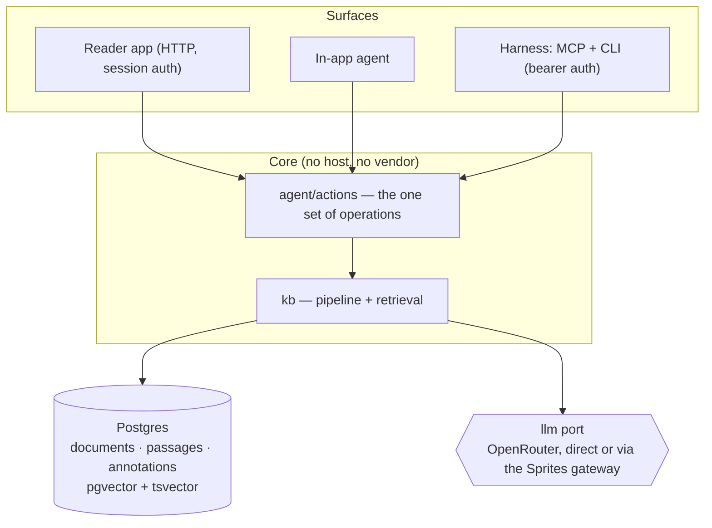
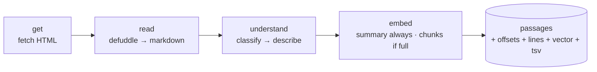
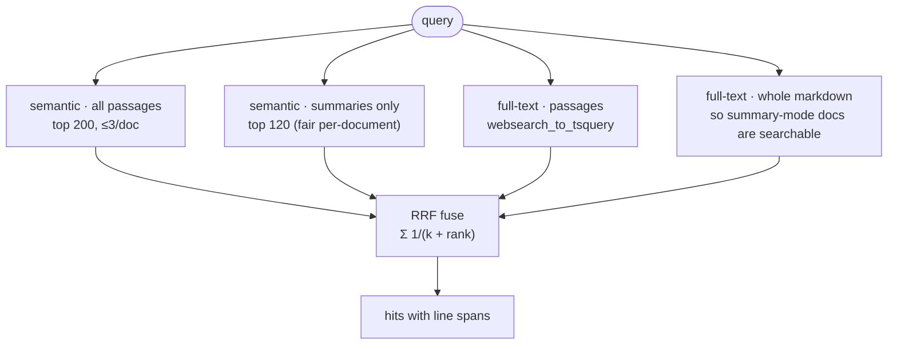
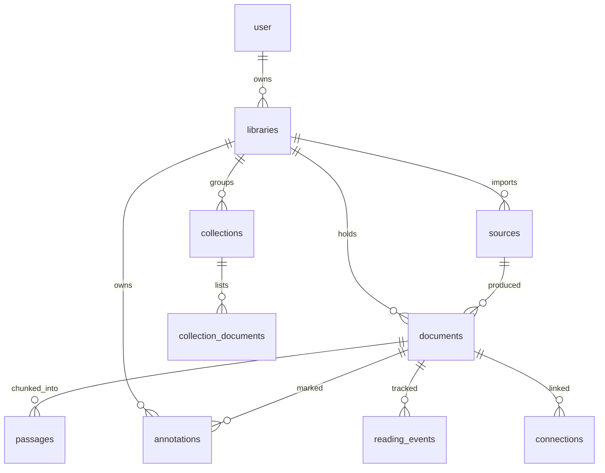
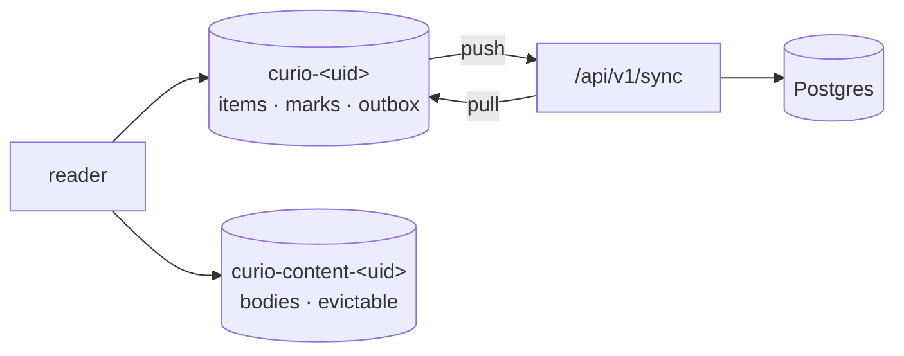

# Architecture

What Curio is, how the pieces fit, and where the hard-won design lives. Read
[`README.md`](README.md) first for the product.

## One library, three surfaces

Every surface reads and writes the same tables. There is one retrieval path, one
agent prompt, one set of tools — the difference between the app, the in-app
agent, and the harness is only *who calls them*.



## The knowledge base

The pipeline is four verbs:



What each verb does, and where it lives:

| Verb | File | State |
| :--- | :--- | :--- |
| **get** | `kb/get.ts` | fetch, 5 redirects, 5MB cap, browser UA. No SSRF guard — inputs are chosen by the reader. |
| **read** | `kb/read.ts` (+ `render.ts` fallback) | defuddle → markdown + metadata. Same seam reads imported HTML. |
| **understand** | `kb/understand.ts`, `kb/prompts.ts`, `kb/categories.ts` | two model calls: classify the page, then describe it in its own voice + topics. |
| **chunk** | `kb/chunk.ts` | **offset-aware** — the one real change. Every passage carries its char offset and line range. |
| **embed** | `kb/embed.ts`, `kb/model.ts` | `text-embedding-3-small`, 1536 dims, batched 100, retries. Summary always; full chunks by mode. |

### Embedding design

Three decisions carry it:

- **What is embedded is not what is stored.** The stored `content` is the bare
  passage; the text sent to the model is `title › heading: content`. A bare
  passage like "it also handles soft deletes well" is unfindable without the
  subject in front of it.
- **Every document gets exactly one summary vector.** The summary is a written
  passage, model-authored. That single vector per document is what makes the
  fair comparison race possible.
- **How much is embedded is a per-document decision.** `full` (articles, tools,
  books, newsletters, PDFs, other) chunks the whole text; `summary` keeps one
  vector. `kind` overrides category for books/PDFs/newsletters — a book is read
  end to end, whatever its landing page looked like.
- **The dimension is fixed in schema and config.** `vector(1536)` matches
  `EMBEDDING_DIM` matches the model. Changing the model is a migration and a
  full re-embed; that is stated where it bites.

What changed for a reading harness:

- **Line-level spans.** `chunk.ts` records `startOffset/endOffset` and derives
  `startLine/endLine`. `content` is a literal slice of the stored markdown, so a
  citation and the source text are the same span.
- **Hybrid retrieval.** Vectors alone miss rare proper nouns. See below.

## Retrieval

`kb/search.ts` runs four ranked lists and fuses them with Reciprocal Rank Fusion.
RRF needs no tuning — one constant, `k = 60`.



Two rules, both learned the hard way:

- **The flood guard.** One long document may contribute at most three passages
  per list. Without it, two 12-chunk articles filled a 60-passage pool and a
  gallery could not surface no matter how relevant.
- **Summaries get their own race.** Every document has exactly one summary, so a
  ranking over summaries alone compares every document on equal footing.

`mode`: `hybrid` (default), `semantic` (vectors only), `exact` (full-text only —
a literal phrase or a rare noun).

## The agent and the tools

`agent/tools.ts` is the reading tool set. Where a coding harness has
`read_file`/`edit_file`, Curio has `read_passage`/`save_annotation`: the unit is a
span, and every read tool returns `{ documentId, startLine, endLine }` the reader
can open.

| Tool | Job |
| :--- | :--- |
| `search_library` | hybrid / semantic / exact, optional kind |
| `read_passage` | open an exact span |
| `list_library` | recent reading, by kind or state |
| `search_annotations` | over your highlights and notes |
| `get_document` | metadata, summary, topics |
| `save_annotation` | write a highlight or note |
| `connect` | an edge between two documents |

The agent may only cite what a tool returned — the UI renders citations from tool
output, never by scanning the model's prose. That is a structural guarantee, not
a prompt request.

## Auth

better-auth owns identity (`src/auth/index.ts`). It writes `user`, `session`,
`account`, `verification`; `src/db/auth-schema.ts` mirrors what its CLI emits.
Nothing hand-rolls a password hash or a session token.

Two credential shapes onto one library:

- the **app** uses the session cookie (`auth.api.getSession`), 
- the **harness** uses a bearer token (the `bearer` plugin), for the CLI and any
  MCP client.

Every app route resolves session → user → library, so no route trusts a client
id. `apiKey` (long-lived, revocable, rate-limited tokens) and OAuth providers
plug in without schema surgery; regenerate `auth-schema.ts` when they do.

## Data model

Full definitions and the reasoning for each column are in
[`src/db/schema.ts`](src/db/schema.ts). The shape:



The one decision that makes this a product: a **document** is any reading item,
identified by `(library_id, external_id)` — a normalized URL for a web page,
`<source>:<id>` for an import. A URL is one kind of id, not the identity. That is
what lets a bookmark, a Kindle highlight, a newsletter issue and an essay be the
same shape.

## Local-first

The browser is the database for what the reader authors. Marks and the library
list live in IndexedDB first, a write appends to a durable outbox, and a sync
loop pushes the outbox and pulls changes back. Server-derived content — the
markdown, the passages, the embeddings — is a cache, not a source of truth, and
is evicted by budget. The full design is in
[`docs/local-first.md`](docs/local-first.md).



## Layout

A Turborepo. The engine is one package; the two runtimes that use it are apps.

```
apps/
  web/                 Next 16 — the reader UI (app/, components/, lib/)
  api/                 Fastify — the API, the agent host, MCP over HTTP
packages/
  core/                the framework-agnostic engine
    kb/                pipeline: get · read · understand · chunk · embed · store · search
    agent/             actions (the operations) + AI SDK tools + prompt + loop
    harness/           MCP server, CLI, scope resolution
    imports/           parsers + ingest for lists, books, newsletters
    db/                schema (every table + the reasoning), auth tables, one client
    auth/              better-auth instance
    config.ts          env, read once
deploy/sprites/        the only Fly-aware code
```

Nothing in `packages/core` imports a host or a vendor. `apps/api` and
`deploy/sprites/` are where the environment shows up.

## The API (`apps/api`)

A Fastify 5 server, structured the way the rest of the stack is: one concern per
plugin, one resource per route module, and an app factory so tests drive it with
`inject()`.

```
apps/api/src/
  app.ts               buildApp(): plugins in load order, TypeBox type provider
  server.ts            listen + close-with-grace (no logic)
  config/env.ts        the environment, parsed by zod once at boot
  plugins/
    config.ts          fastify.config
    db.ts              fastify.db (the shared pool, closed on shutdown)
    auth.ts            onRequest → request.auth; requireAuth preHandler
    error-handler.ts   one failure shape for every route
    security.ts        helmet · CORS allow-list · global rate limit
    swagger.ts         OpenAPI + Scalar + Swagger UI
  routes/
    index.ts           the tree: /health, /mcp, then /api/v1
    health/  mcp/
    v1/                me · library · search · documents · annotations · ask
  schemas/response.ts  the shared error schema
  types/fastify.d.ts   the instance's shape (config, db, requireAuth, request.auth)
```

Rules the API follows:

- **Schemas are the contract.** Request and response schemas are TypeBox; they
  validate, serialize, *and* generate the OpenAPI document, so docs cannot drift.
- **One failure shape.** `{ error: { code, message, details?, why?, fix? } }`.
  Validation becomes a 400 with per-field details; an evlog `createError` keeps
  its `why`/`fix`.
- **Routes are thin.** Identity comes from `request.auth`; the engine does the
  work; the handler's job is to add context to the request's wide event.
- **Logging is wide events.** `evlog` emits one context-rich event per request
  (user, library, search, duration) — see `apps/api/AGENTS.md`.

### Docs

| URL | What |
| :--- | :--- |
| `/docs` | Scalar reference |
| `/swagger` | Swagger UI |
| `/docs/openapi.json` | the raw OpenAPI 3.1 document |

Both renderers read the one document `@fastify/swagger` builds from the route
schemas.
