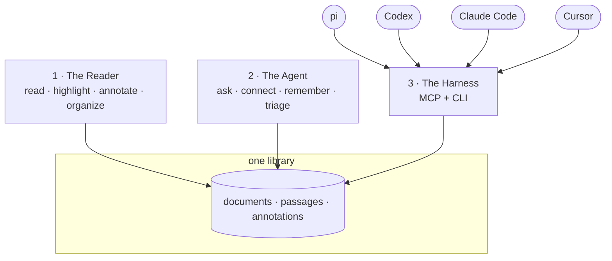

# Curio

**A reading app with an agent — and a harness your other agents can use.**

You import everything you read into one library: articles, newsletters, books,
PDFs, and the links piling up in your browser and read-later apps. Curio reads
each one, stores its text, and makes every word searchable. Then it gives you
three doors onto that library.



## The three surfaces

| # | Surface | What it is |
| :-- | :--- | :--- |
| 1 | **The Reader** | The app. Read anything you've saved in a serious, distraction-free reader. Highlight a line; it stays. Browse by topic; see what you haven't read. |
| 2 | **The Agent** | Lives in the app. Answers from your library with **line-level citations** that open the exact passage. Connects what you've read, remembers what you highlighted, triages your inbox. |
| 3 | **The Harness** | The same tools over **MCP** and a **CLI**, so the agent you already use — pi, Codex, Claude Code, Cursor — can read your library and write to it mid-task. Your reading, available to every agent you run. |

One library. Three doors. Not a chatbot on a links page.

## What makes it reading-first

Coding harnesses optimize for *edit → run → fix*. Curio optimizes for
*find → read → remember → connect*. That changes the citation unit, the tool
set, and what gets stored.

| | A coding harness | Curio |
| :--- | :--- | :--- |
| Reads | a file | a **span of lines** (`document, start_line, end_line`) |
| Cites | a path | a **line range** the reader scrolls to and flashes |
| Search | grep or symbols | **semantic + full-text**, fused |
| Memory | none between runs | highlights, notes, reading history, spaced recall |
| Skills | edit · run · fix | **reading playbooks** — `triage`, `quiz`, `connect`, `brief`, `steelman` |
| Output | a diff | an answer, or a note written back to your library |

## Quickstart

```bash
cp .env.example .env          # DATABASE_URL + a model key (or use the Fly connector)
bun install
bun run db:migrate            # create the schema
bun run dev                   # the app + API
bun run cli -- import <path>  # import a reading list, EPUB, or bookmarks file
```

Point your own agent at it:

```bash
# Claude Code / Cursor / pi — speak MCP
bun run mcp
```

Deploy on a Fly Sprite: [`docs/deployment.md`](docs/deployment.md).

## Reading skills

A skill is a named way to read, authored as `skills/<name>/SKILL.md` with YAML
frontmatter — the portable agent-skills format. The agent sees the index in its
prompt and loads the playbook that matches; an MCP client sees each as a prompt.
The same tools — only the reading changes.

| Skill | What it does |
| :--- | :--- |
| `build-persona` | read the library, write a `reader_persona.md` the other skills use |
| `triage` | walk the unread pile one at a time, say what each is worth |
| `quiz` | test yourself on what you read, graded one question at a time |
| `brief` | the argument of one piece, fast, with line citations |
| `connect` | place a piece against the library; record the edges |
| `book-review` | a long-form review that synthesizes the book with the wider library |
| `reader-recap` | a conversational briefing on your recent reading |
| `surprise-me` | one thing about your reading you have not noticed |
| `curio-mcp` · `curio-cli` | how to use the tools, for any agent |

Because they are plain markdown in `skills/`, they install into any agent that
speaks skills (pi, Claude Code, Codex, Cursor) via the plugin manifest, and the
in-app agent loads the same files.

```bash
curio skills            # list them
curio skill triage      # print one playbook
curio ask "clear my pile" --skill triage
```

## Documents

- [`ARCHITECTURE.md`](ARCHITECTURE.md) — the system, the data model, the knowledge base, retrieval.
- [`docs/imports.md`](docs/imports.md) — every source you can bring: lists, newsletters, books.
- [`docs/harness.md`](docs/harness.md) — the tool set, MCP, CLI, and the agent.
- [`docs/deployment.md`](docs/deployment.md) — Sprites + connector now, anything later.
- [`docs/design.md`](docs/design.md) — the design system: surfaces, type, density, the frame.
- [`docs/local-first.md`](docs/local-first.md) — the browser as the database: local truth, the outbox, the sync feed.

## Status

Early. The pipeline does read → understand → chunk → embed → retrieve, with
citations. Line-level spans, hybrid search, imports and the harness are in.

## Built with

TypeScript on Node. Postgres with pgvector and full-text search. The Vercel AI
SDK for the agent loop. Fastify for the API — evlog wide events, Scalar and
Swagger docs. Defuddle for reading pages.
Portable by design — nothing in the core depends on Fly, Next.js, or any host.
