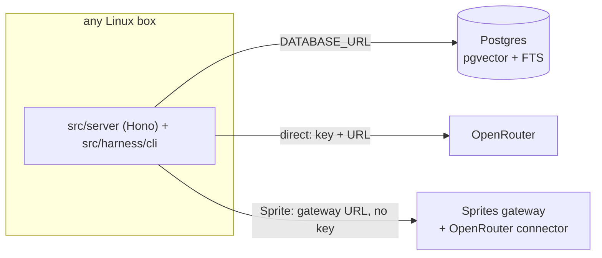

# Deployment

The core is host-agnostic. Fly appears in exactly two places — where the process
is launched, and where model calls are pointed. Change those and Curio runs
anywhere.



## Environment

| Variable | Needed | Notes |
| :--- | :--- | :--- |
| `DATABASE_URL` | always | Postgres with `pgvector` and full-text search. Neon, Fly MPG, or local. |
| `BETTER_AUTH_SECRET` | always | `openssl rand -base64 32`. |
| `BETTER_AUTH_URL` | app | The app's public base URL. |
| `OPENROUTER_API_KEY` | unless gateway | A model key. |
| `SPRITES_GATEWAY_URL` | on a Sprite | The OpenRouter connector gateway base. Replaces the key. |
| `EMBEDDING_DIM` | always | 1536 unless you re-embed everything. |
| `PORT` | app | Default 8787. |
| `CHROME_PATH` | optional | System Chrome for the JS-page render fallback. |

Two model homes, chosen by env, not code (`src/kb/model.ts`):

```
direct : createOpenRouter({ apiKey: OPENROUTER_API_KEY })
Sprite : createOpenRouter({ apiKey: "sprites-gateway", baseURL: SPRITES_GATEWAY_URL })
```

## Postgres

Any Postgres with pgvector. Neon is the one this repo is wired for (see below);
the connection strings are generic, so any Postgres works.

```bash
bun run db:generate    # schema → SQL, only after a schema change
bun run db:migrate     # apply, over the direct connection
```

The migration starts with `CREATE EXTENSION IF NOT EXISTS vector;`. Full-text
search is built into Postgres — no second service. Migrations run over the
**direct** URL (`DATABASE_URL_UNPOOLED`): Neon's pooled endpoint is PgBouncer in
transaction mode and breaks DDL in ways that never name pooling. `db:push` is
deliberately absent — it reconciles away objects the schema does not declare.

## Neon

```bash
neon init -y --org-id <org> --project-id <project> --branch production --services postgres
neon deploy        # provisions the services in neon.ts, writes .env.local
```

`.env.local` then carries `DATABASE_URL` (pooled) and `DATABASE_URL_UNPOOLED`
(direct). Two things the app does with them:

- `src/db/index.ts` connects with the **pooled** URL and sets `prepare: false`
  when it sees `-pooler`, because transaction-mode pooling collides on named
  prepared statements.
- `drizzle.config.ts` connects with the **unpooled** URL for migrations.

Neon's own `lakebase_vector` / `lakebase_bm25` extensions would give BM25
ranking and a native fusion path (and Jev reranking). We stay on standard
`pgvector` + `tsvector` + RRF on purpose: the harness must also run on plain
Postgres (Fly MPG, a VPS, a container). Switch to the Neon-native path only if
the project is Neon-only.

## Run

```bash
bun install
bun run start          # HTTP app + API
bun run cli report     # the harness, same code
```

A container only needs Node 22, the env, and `bun run start`. That is the whole
portability story: no Fly SDK, no host binding, no vendor runtime.

## On a Fly Sprite (the Hacksgiving build)

A Sprite is a persistent, hardware-isolated Linux VM — a good home for an agent
that should keep its state and wake on demand. `deploy/sprites/` holds the only
Fly-aware code.

```bash
# 1. Create the Sprite and get in.
sprite create curio
sprite console -s curio

# 2. Put the code and env in place.
git clone <repo> /srv/curio && cd /srv/curio
cp .env.example .env      # DATABASE_URL, BETTER_AUTH_SECRET, BETTER_AUTH_URL

# 3. Run it as a service (Sprites keep services running, scaling to zero).
bash deploy/sprites/boot.sh
```

### The connector (required, and genuinely used)

Model calls leave the Sprite through the **Sprites gateway**, which holds the
credential. No key lives in the box.

1. In the Fly organization, add an **OpenRouter** connector. The managed
   connector needs no OpenRouter account; a BYOK connector works the same.
2. Grant it access to the Sprite (by name prefix or label). Deny-by-default: a
   connector with no policy reaches nothing.
3. Set the gateway base on the Sprite:

   ```
   SPRITES_GATEWAY_URL=https://api.sprites.dev/v1/gateway/openrouter/<connection_id>/api/v1
   ```

   `src/kb/model.ts` points the provider there and stops — no other code changes.

Gateway calls only succeed from inside a running Sprite, which is why the agent
runs there rather than as a thin proxy. That constraint and the "runs on a
Sprite" rule are the same requirement seen twice.

### Verify

```bash
curl -s https://api.sprites.dev/v1/gateway/list          # what's connected
bash deploy/sprites/check.sh                              # health + a real model call
```

## Leaving Fly

Nothing in `src/kb/` or `src/agent/` knows where it runs. To move: deploy the
same `bun run start` to Fly Machines, Railway, a VPS or a container host, set
`OPENROUTER_API_KEY`, and drop `SPRITES_GATEWAY_URL`. `deploy/sprites/` stops
being used; nothing else changes.
