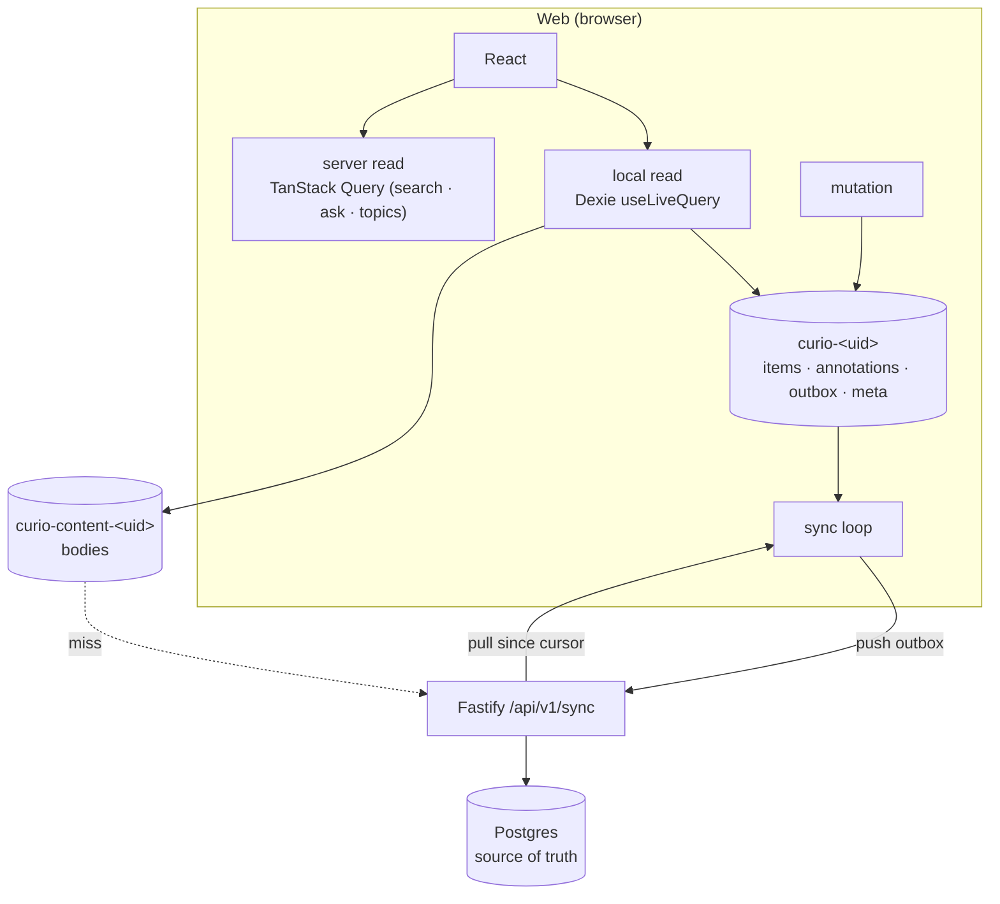

# Local-first

How Curio should read and write data so the UI never waits on the network. This
is a spec, not a description of the build — the build still ships the persisted
query cache in `apps/web/src/lib/persist.ts`. The migration is at the bottom.

Two references:

- **Matter** — the object-store layout, read from its running IndexedDB
  (`docs/tmp.txt`). A per-user library DB (`items`, `annotations`, `notes`,
  `bodies`, `bodyMeta`, `outbox`, `tags`) plus a separate content DB
  (`MatterDexie`). `items` is a denormalized read model with a sort-key index per
  view; `outbox` is a durable write queue.
- **Linear** — [`how-is-linear-so-fast…`](./how-is-linear-so-fast-a-technical-breakdown.md).
  The server is a sync target, not the source of truth for the UI; mutations
  apply locally and reconcile in the background; heavy tables lazy-hydrate.

We copy the mechanism, not the product. Curio is a single-user reading app, so
none of this needs CRDTs, WebSocket deltas, or per-field observables.

## The one idea

Split the data by **who owns it**, and give each half its own store:

| Class | Examples | Owner | Local strategy |
| :--- | :--- | :--- | :--- |
| **Derived content** — heavy, server-produced, immutable | `markdown`, `passages`, summary, topics, embeddings | server pipeline | cache per document, lazy, evictable |
| **User state** — small, mutable, hand-authored | annotations, `readState`, `favorite`, collections | the client | local truth + outbox |
| **Read model** — a projection for lists and counts | library rows, counts | derived | IndexedDB indexes, built locally |

Today all three are one thing: a TanStack Query cache serialized to a single
`cache` row (`curio` DB). That is why the DevTools tree is empty and every
filter is a network round trip wrapped in optimistic paint. One owner per datum
removes the confusion and most of the code.



## Two databases (from Matter)

Matter runs two DBs because the two halves have opposite lifecycles: the library
must never be evicted, content should be. Same split here.

### `curio-<userId>` — the library, local truth

```
items        keyPath id          readState, favorite, kind, category, addedAt,
                                 lastReadAt, tags* , topics*        (* multiEntry)
annotations  keyPath id          documentId, createdAt
collections  keyPath id
outbox       keyPath ++seq       entityType, entityId
meta         keyPath key         userId · cursor · schemaVersion
```

`items` is the denormalized row the list and every filter read: one row per
document, carrying both server fields (title, author, summary) and user fields
(`readState`, `favorite`). Every view is an index scan; counts come from
`store.count()`, not the server.

Per-user DB name (Matter's `matter-u341500`) over clear-on-sign-out: the data
literally cannot belong to the wrong identity.

### `curio-content-<uid>` — derived content, cache

```
bodies       keyPath documentId   indexes: lastAccess
meta         keyPath key          (the running byte total)
```

A document's stored markdown, fetched lazily when it is opened and evicted
oldest-opened-first against a byte budget. A document opened once is readable
offline; one never opened falls back to the API.

Rules that keep it working with a large library:

- **One row at a time.** A body is read by id, never by loading the store.
- **A small in-memory set** (five bodies) makes navigating back synchronous — no
  loading frame on a reopen.
- **A byte budget, not a count.** Eviction runs in a transaction so two writers
  cannot race the counter; a `QuotaExceededError` drops to half and retries once.
- **Concurrent reads of one body share a fetch.**
- **An empty body is not cached.** An unfinished pipeline returns nothing; caching
  it would freeze "no text" forever. It is re-fetched next open.
- **A failed fetch is not cached either,** and is reported as offline rather than
  as an empty article.

### The offline shell

`apps/web/public/sw.js` caches the app itself, so the reader opens with no
network.

- **Install** fetches `/`, pulls every `/_next/static/*` the document points at,
  and caches them. The whole bundle is a handful of chunks, so the *first* visit
  is enough — no precache manifest, no build step.
- **Navigations** are network-first, falling back to the cached shell.
- **Hashed assets** are cache-first; they are content-addressed and immutable.
- **The API is never cached.** The app's own data layer owns it; a second cache
  underneath the sync engine would only serve it stale data.
- The worker script is served `no-cache`, so a deploy is picked up; the cache is
  versioned, and old versions are deleted on activate.

Registered in production only (`ServiceWorker.tsx`); in dev any leftover worker
is unregistered, so HMR is never shadowed by a cache.

## Documents are server-created; marks are client-created

This is the simplification that keeps the engine small. A document cannot be
created offline — reading the page needs the server pipeline (`get → read →
understand → embed`). Annotations can, and that is the only thing the user
authors by hand.

So `documents.id` stays a Postgres `bigint`, and an annotation keeps its row
`id` as the target of `connections`' foreign keys. Alongside it, an annotation
carries **`client_id uuid`** (`crypto.randomUUID()`), and *that* is the name
every surface outside the table uses — the reader, the outbox, the pull feed,
the harness. A mark has a stable identity before the server has ever seen it,
which is what makes an offline create durable and its push idempotent.

The deviation from the first draft, recorded: marks were to *become* the uuid
table key. They did not. Keeping `id bigint` left `connections`' FKs untouched
and avoided a destructive rewrite for existing rows; `client_id` is the sync
identity and `id` is internal. If `connections` ever needs to be addressed by
client id (it does not today), the FKs move then.

## The outbox (from Matter)

Every local mutation writes the store and appends one row. The store is the
truth; the outbox is the retry log.

```ts
interface OutboxRow {
  seq?: number;                 // autoIncrement — the local order
  id: string;                   // client uuid — the idempotency key
  entityType: "annotation" | "document" | "collection";
  entityId: string;
  op: "create" | "patch" | "delete";
  payload: Record<string, unknown>;
  createdAt: number;
  attempts: number;
}
```

Flush: batch (≤100) → `POST /api/v1/sync/push` → server applies idempotently by
`id` → returns applied ids and the new cursor → delete those rows. On failure,
increment `attempts` and back off; the row survives reload, which is the whole
point. Triggers: on mutation, on `online`, on a 30s interval.

Idempotency is the robustness property. A retried push must not double-create,
so the server upserts on the client id.

## The pull (simpler than Linear's)

Single user, thousands of documents — a change feed is enough; no WebSocket.

```
GET /api/v1/sync/pull?since=<cursor>
→ { cursor, changed: { items, annotations, collections }, deleted: [...] }
```

Cursor is `(updatedAt, id)`, monotonic per row. Every table needs `updatedAt`;
deletes need a tombstone (`deletedAt`) so the client learns about them — the one
schema cost of this design. A `library_events` table written by a trigger is the
robust upgrade when app-code writes get forgotten; not needed yet.

Boot is Linear's order, not the conventional one:

1. Read `items` from IndexedDB → render the library. No spinner.
2. Kick off `pull?since=cursor` in the background → apply deltas.
3. The first sync that 401s → sign out. Auth is assumed from local state and
   verified by the request that follows, never by a blocking `/me`.

## What we keep versus retire

| Keep | Retire |
| :--- | :--- |
| TanStack Query for **server-only** reads: search, topics, ask, connections | `@tanstack/react-query-persist-client` and `apps/web/src/lib/persist.ts` |
| Radix, the design system, the shell | the single serialized `cache` row |
| Postgres as source of truth | the four hand-written optimistic `onMutate`/`onError`/`onSettled` triples |

Local entities are read with Dexie's `useLiveQuery`, so a write repaints the
component without an `invalidateQueries` dance. Server-only reads stay in Query
and stay unpersisted.

## Deliberately not copied

- **CRDTs / Yjs / WebSocket deltas.** Linear needs multi-client realtime; Curio
  has one reader. `pull` on focus is enough.
- **Per-property observables.** MobX exists to re-render one cell in a 50-issue
  list. A reading list is coarse-grained; React re-render is fine.
- **MobX as the store.** Dexie is already the dependency and already the
  IndexedDB base. A second store is not justified.

## Migration

Each step ships alone.

| # | Step | State |
| :-- | :--- | :--- |
| 1 | **Spec** — this file; link it from `ARCHITECTURE.md`. | in review |
| 2 | **Schema** — `client_id uuid unique` + `updated_at` on annotations; `deletedAt` tombstones on annotations. | **done** |
| 3 | **API** — `POST /api/v1/sync/push` (batch, idempotent), `GET /api/v1/sync/pull`; in `packages/api-client`. | **done** |
| 4a | **Web store, marks** — the `curio-<uid>` DB, the outbox, the sync loop; the reader's marks read from IDB and write through the outbox. | **done** |
| 4b | **Web store, items** — the library list, counts, read state and star read from IDB. | **done** |
| 4c | **Content cache** — `curio-content-<uid>` holds document bodies, LRU-evicted; cache-first reads and lazy prefetch. | **done** |
| 5 | **Retire** `apps/web/src/lib/persist.ts` and the persist providers. | **done** |
| 6 | **Offline shell** — a service worker caches the shell and the hashed build assets. | **done** |

Where the build stands: the library list, read state, star, and marks are local
truth — written to IndexedDB, durable offline, pushed idempotently on reconnect,
and pulled with tombstones from another device. An opened document's body is
cached, so it reads offline and reopens without a request. Identity is seeded
from the last successful answer, so an offline cold start renders the app
instead of the sign-in screen. TanStack Query keeps only what has no local copy
(search, the agent, topics, connections). The service worker caches the shell, so
the app boots with no network at all; the theme is set by an inline script
before paint, so the offline shell is already the right colour.

One honesty note: the list filters are an in-memory scan over the `items` store,
not an index seek. It is already local (no request, no network), which is the
win; the store carries the indexes (`readState`, `favorite`, `kind`, `category`,
`addedAt`) to move the common filters onto them when the library is large enough
for it to matter.
